# MAUDE RAG: Question Answering Procedure

| Field | Value |
|---|---|
| **Document title** | Building and Running Question Answering over FDA MAUDE Reports |
| **Document type** | Procedure |
| **Revision** | E |
| **Effective date** | 2026-11-13 |
| **Applies to** | Steps 1 to 5 of the project roadmap (see Section 9) |

> This is a learning project built in public. The document borrows the layout of a quality system procedure for clarity; it is not a controlled document and is not part of any certified quality management system.

---

## 1. Purpose

This procedure describes how to set up and run question answering over the FDA's [MAUDE](https://www.fda.gov/medical-devices/mandatory-reporting-requirements-manufacturers-importers-and-device-user-facilities/manufacturer-and-user-facility-device-experience-database-maude) database of medical device adverse event reports, The system reads a question and chooses how to answer it: by searching the reports (retrieval-augmented generation, RAG), by counting them with a database query, or with an agent that combines several steps, including a lookup of FDA recalls. The project is built in public, one step at a time.

## 2. Scope

**In scope**

- About 3,000 insulin pump reports received by the FDA in 2025 (250 per month, spread across every day of the month; a few duplicates are dropped). A month whose last days have no reports can fall short, because no later day can take up their share: August 2025 has 234.
- The reporter's "Description of Event or Problem" text from each report.
- Downloading the reports, indexing them, and asking questions against them.
- Narrowing a search by event type, brand, manufacturer and date received.
- Counting and ranking reports with LLM-written database queries.
- Routing each question to search, counting, or the agent.
- An agent for multi-step questions, with live lookup of FDA insulin pump recalls.
- Scoring retrieval (20 questions), counting (12 questions) and routing (41 questions).

**Out of scope**

- Other device types and other years.
- The manufacturer's follow-up narrative in each report.
- Scoring the quality of the written answers and of the agent's work. Retrieval, counting queries and routing decisions are scored; the prose is not.

## 3. Definitions

| Term | Definition |
|---|---|
| **MAUDE** | Manufacturer and User Facility Device Experience: the FDA's database of medical device adverse event reports |
| **openFDA** | The FDA's free public data service, used here to download reports |
| **RAG** | Retrieval-augmented generation: look up relevant text first, then have an LLM answer from it |
| **Chunk** | A piece of a report narrative, short enough for the embedding model to read in full |
| **Embedding model** | A program that turns text into a list of numbers representing its meaning |
| **Vector DB** | A database that finds the stored texts closest in meaning to a query |
| **LLM** | Large language model: the program that writes the final answer |
| **BM25** | A keyword-scoring formula: ranks text by shared words, weighting rare words more |
| **Hybrid search** | Vector search and keyword search run together, with results merged by reciprocal rank fusion |
| **Metadata filter** | A condition on report facts, applied before results are ranked |
| **Test set** | A fixed list of questions, each with the reports that count as correct answers (`eval/questions.json`) |
| **Pooling** | Building a test set by reading the combined top results of every search method, so no method is favoured |
| **Hit rate** | The share of questions for which at least one correct report was retrieved |
| **Precision** | The share of retrieved reports that are correct, averaged over questions |
| **MRR** | Mean reciprocal rank: 1 if the first correct report ranks first, 1/2 if second, and so on, averaged over questions |
| **SQL** | The standard language for querying a database, used here for counting questions |
| **Router** | The step that reads a question and chooses search, SQL or the agent |
| **Adaptive RAG** | A RAG system that picks its answering method per question instead of always searching |
| **Agent** | An LLM that decides which tools to call, in what order, and when it has enough to answer |
| **Recall** | An FDA record of a manufacturer correcting or removing a device; looked up live from openFDA |

A fuller glossary is in [docs/explainers](docs/explainers/README.md).

## 4. Responsibilities

| Role | Responsibility |
|---|---|
| **User** | Runs this procedure and supplies their own Anthropic API key for the steps that call the LLM |
| **Test set reviewer** | Checks each test question and its correct reports, then sets `"reviewed": true`; checks the reference queries in `eval/counting.json` and the expected routes in `eval/routing.json` |
| **Reader of an answer** | Interprets the output within the limits stated in Section 7 |

## 5. References

| Reference | Location |
|---|---|
| openFDA device event API | <https://open.fda.gov/apis/device/event/> |
| openFDA device recall API | <https://open.fda.gov/apis/device/recall/> |
| Chroma vector database | <https://www.trychroma.com/> |
| Plain-language walkthrough of each code file | [docs/explainers](docs/explainers/README.md) |
| Codebase floor plan | [docs/floor-plan.svg](docs/floor-plan.svg) (static), [docs/floor-plan.html](docs/floor-plan.html) (interactive) |

## 6. System Description

### 6.1 Process flow

```
Reports ─┬─> chunk ─> embedding model ─> vector DB (with metadata)
         └─> SQLite database (reports and coded problems)

Question ─> router (LLM) ─┬─ search ─> hybrid search ─> prompt ─> LLM ─> answer quoting reports
                          ├─ sql ────> LLM writes query ─> read-only database ─> LLM explains counts
                          └─ agent ──> LLM calls tools in a loop:
                                       search_reports, run_sql, check_recalls (openFDA, live)

Hybrid search:
Question ─┬─> embedding model ─> nearest chunks ─┐
          │                                      ├─> merge (RRF) ─> top chunks
          └─> BM25 keyword scores ─> top chunks ─┘
          (optional filters narrow both searches first)
```

### 6.2 Components

| Component | Selection | Notes |
|---|---|---|
| **Data** | Insulin pump reports from the openFDA API | 3,000 reports from 2025, 250 per month, about 9 per day |
| **Embedding model** | `all-MiniLM-L6-v2` | Small, open-source, runs locally on a CPU |
| **Vector DB** | Chroma | Stored on disk in `data/chroma`; also applies the metadata filters |
| **Keyword search** | BM25, written in plain Python | No extra package; see `maude_rag/keyword.py` |
| **Database** | SQLite (built into Python) | `data/reports.db`; opened read-only for LLM-written queries |
| **LLM** | Claude (`claude-opus-5-5`) | Called through the Anthropic API, all calls in `maude_rag/llm.py`; retried on a fallback model if declined |
| **Router** | One LLM call at low effort | Returns route, reason and filters as checked JSON |
| **Agent** | Anthropic SDK tool runner | At most 10 rounds of tool calls; each call and a preview of its result is printed |
| **Recalls** | openFDA device recall API | Fetched live; the four insulin pump product codes only |

### 6.3 Codebase map

The codebase drawn as a plant floor plan. Each room is one Python file, and its floor area is proportional to the file's line count (1 line = 150 square units). Rooms marked NTS (not to scale) are data stores, documents and outside services. Conveyors follow the actual imports; numbered badges give the order of travel on each route.



| Zone | Rooms | Role |
|---|---|---|
| Receiving and processing (yellow) | `ingest.py`, `index.py` | Download the reports and build both stores (steps 7.2 and 7.3) |
| Storage (blue) | `data/reports.jsonl`, `data/chroma`, `data/reports.db`, `eval/` | Raw reports, the vector index, the counting database, and the test sets with their results |
| Production cells (green) | `router.py`, `ask.py`, `keyword.py`, `sql.py`, `agent.py` | Answer questions: dispatch, search, counting and the agent |
| Utilities (purple) | `config.py`, `llm.py` | Shared settings and the single connection to Claude |
| Quality lab (pink) | `evaluate.py`, `evaluate_llm.py`, `tests/` | Measure the cells and check the building blocks |
| Document control (grey) | `README.md`, `docs/` | This procedure and the explainers |

| Line | Meaning |
|---|---|
| Solid, orange | Build: data moving into the stores |
| Solid, green / blue / violet | The search, count and agent routes |
| Dashed, magenta | An LLM call, made through `llm.py` |
| Dotted, teal | A quality gauge measuring a cell |

An LLM tag marks a room that calls Claude. An amber ring marks a room that is built and unit-tested but not yet run against the API. The interactive version, [docs/floor-plan.html](docs/floor-plan.html), highlights one route at a time and shows each room's inputs, outputs and command; download it and open it in a browser, since GitHub shows HTML files as source.

### 6.4 Prerequisites

| Item | Needed for |
|---|---|
| Python 3 | All steps |
| Internet access | Steps 7.1 and 7.2, the first run of step 7.3 (model download), and every step that calls the LLM or looks up recalls |
| Anthropic API key | Steps 7.7 to 7.10 and 7.13 |

## 7. Procedure

### 7.1 Set up the environment

```bash
python -m venv .venv && source .venv/bin/activate
pip install --index-url https://download.pytorch.org/whl/cpu torch
pip install -r requirements.txt
```

### 7.2 Download the reports

```bash
python -m maude_rag.ingest
```

**Expected result:** reports are saved to `data/reports.jsonl`. This makes one request per day of the year and takes a few minutes.

### 7.3 Build the index

```bash
python -m maude_rag.index
```

**Expected result:** the narratives are embedded and stored in `data/chroma`, and the reports are written to the database `data/reports.db`. This takes about a minute on a CPU.

### 7.4 Run a retrieval-only query

No API key is needed for this step.

```bash
python -m maude_rag.ask --retrieve-only "pump screen went blank"
```

**Expected result:** a list of the best matching report excerpts. Each line shows a similarity score (or `-` when only keyword search found it), which search found it (`vector`, `keyword` or `both`), and the report number.

### 7.5 Narrow the search with filters

Filters are optional and can be combined. Brand and manufacturer accept any part of the name.

```bash
python -m maude_rag.ask --values brand_name          # list brand names and counts
python -m maude_rag.ask --retrieve-only --event-type Death "occlusion"
python -m maude_rag.ask --retrieve-only --manufacturer "beta bionics" "cartridge"
python -m maude_rag.ask --retrieve-only --brand 780g --since 20250101 --until 20250131 "screen blank"
```

| Option | Accepts |
|---|---|
| `--event-type` | `Malfunction`, `Injury` or `Death` |
| `--brand`, `--manufacturer` | Any part of the name, in any case |
| `--since`, `--until` | A date as `YYYYMMDD`, inclusive |

**Expected result:** only reports matching every filter are returned. If none match, a message says so.

### 7.6 Compare search methods

```bash
python -m maude_rag.ask --retrieve-only --mode vector  "occlusion alarm"   # step 1 baseline
python -m maude_rag.ask --retrieve-only --mode keyword "occlusion alarm"
python -m maude_rag.ask --retrieve-only                "occlusion alarm"   # hybrid (default)
```

**Expected result:** three lists for the same question, showing what each method finds.

### 7.7 Run a full question

This step needs an Anthropic API key.

```bash
export ANTHROPIC_API_KEY=...
python -m maude_rag.ask "What problems are reported with infusion sets?"
```

**Expected result:** the retrieved excerpts, followed by a written answer that cites report numbers. Adding `--json` prints the same answer as one JSON record (answer, cited and retrieved report numbers, and the configuration that produced it), for use by a validation harness.

### 7.8 Ask a counting question

This step needs an Anthropic API key.

```bash
python -m maude_rag.sql "How many injury reports did each manufacturer have?"
python -m maude_rag.sql --show-schema    # what the LLM is told about the database
```

**Expected result:** the query the LLM wrote, the rows it returned, and a short explanation. Check the query: it is the evidence for the numbers. If the first query fails, the LLM gets one retry with the error message.

### 7.9 Ask any question and let the router choose

This step needs an Anthropic API key.

```bash
python -m maude_rag.router "What do reports say about pumps getting wet?"            # search
python -m maude_rag.router "Which month had the most death or injury reports?"       # sql
python -m maude_rag.router --route-only "Have there been recalls of Omnipod pods?"   # agent, decision only
```

**Expected result:** the chosen route with a one-sentence reason and any filters, then the answer from that route.

### 7.10 Ask a multi-step question

This step needs an Anthropic API key and internet access for the recall lookup.

```bash
python -m maude_rag.agent "Compare the problems reported for Tandem and Insulet pumps, then check for recalls"
```

**Expected result:** one line per tool call (`-> search_reports(...)`, `-> run_sql(...)`, `-> check_recalls(...)`), each followed by a preview of what the tool returned, then an answer citing report numbers and recall event numbers. The agent stops after 10 rounds of tool calls and says so if it was cut short.

### 7.11 Verify the installation

```bash
python -m pytest
```

**Expected result:** all tests pass.

### 7.12 Evaluate retrieval

No API key is needed for this step.

```bash
python -m maude_rag.evaluate -v
```

**Expected result:** a table scoring each search method (`vector`, `keyword`, `hybrid`) by question type, followed by one table per method with a row per question. The `Unjudged` column should be 0; if it is not, a method retrieved reports that nobody has judged, and those questions need more reading before the scores can be trusted.

To keep a record, save the output with the date and a run number (`N` is 1 for the first run that day, then 2, and so on). Never overwrite an earlier record:

```bash
python -m maude_rag.evaluate -v > eval/results/YYYY-MM-DD-N.md
```

Add the procedure revision, the data download date, and any observations at the top of the file, as in `eval/results/2026-11-13-2.md`. If the test set changed since the last run, say what changed and why.

**Limits:** the test set has 20 questions, so one question is 5 percentage points of hit rate. It was drafted by Claude and has not yet been reviewed by a person; until it is, treat the scores as provisional.

### 7.13 Evaluate counting and routing

This step needs an Anthropic API key. Each question costs one or more LLM calls.

```bash
python -m maude_rag.evaluate_llm --suite counting -v
python -m maude_rag.evaluate_llm --suite routing -v
```

**Expected result:** for counting, how many of the 12 questions in `eval/counting.json` produced the same rows as the reference query. For routing, how many of the 41 questions went to the expected route, with a breakdown of the mistakes. Save each run as in step 7.12.

**Limits:** the agent's answers are not scored. Whether an answer is complete and correct still needs a person to read it.

### 7.14 Interpret the answers

Apply these limits to every answer:

1. MAUDE is a passive reporting system. Reports are unverified and may be duplicated.
2. A report does not show that a device caused an event.
3. Report counts are not incidence rates.
4. Counts come from a sample of about 3,000 reports, not every report the FDA received.
5. Recalls come from a separate FDA database and may concern other devices or years than the reports.
6. Check the query behind any count, and the cited reports behind any claim.
7. Nothing produced by this project is medical advice.

## 8. Records

| Record | Location | Created by |
|---|---|---|
| Downloaded reports | `data/reports.jsonl` | Step 7.2 |
| Vector index | `data/chroma` | Step 7.3 |
| Counting database | `data/reports.db` | Step 7.3 |
| Retrieval test set | `eval/questions.json` | Written by hand; see [docs/explainers/evaluate.md](docs/explainers/evaluate.md) |
| Counting and routing test sets | `eval/counting.json`, `eval/routing.json` | Written by hand; see [docs/explainers/evaluate_llm.md](docs/explainers/evaluate_llm.md) |
| Evaluation results | `eval/results/YYYY-MM-DD-N.md` | Steps 7.12 and 7.13 |

The `data` folder is excluded from version control and is rebuilt by repeating steps 7.2 and 7.3. The `eval` folder is kept in version control, so results can be compared over time.

## 9. Roadmap

| Step | Description | Status |
|---|---|---|
| 1 | Naive RAG baseline, measured on a test set | Covered by this procedure |
| 2 | Metadata filters and keyword search | Covered by this procedure |
| 3 | SQL path for counting questions | Covered by this procedure; not yet run against the API |
| 4 | Query router (Adaptive RAG) | Covered by this procedure; not yet run against the API |
| 5 | Agentic retrieval | Covered by this procedure; not yet run against the API |

## 10. Revision History

| Revision | Date | Description |
|---|---|---|
| A | 2026-11-13 | Initial release: Naive RAG baseline |
| B | 2026-11-13 | Added metadata filters, BM25 keyword search and hybrid retrieval (roadmap step 2). Changed the download to sample every day of each month; Revision A took only the first day or two of each month. Repeat steps 7.2 and 7.3 after updating |
| C | 2026-11-13 | Added the 20-question test set and the retrieval scorer (step 7.9), completing roadmap step 1's baseline. Results recorded in `eval/results/2026-11-13-1.md` (first draft of the test set) and `eval/results/2026-11-13-2.md` (six weak questions replaced) |
| D | 2026-11-13 | Added the SQL path (step 3), the router (step 4) and the agent with live recall lookup (step 5), with steps 7.8 to 7.10 and 7.13. Steps 7.8 to 7.10 renumbered to 7.11, 7.12 and 7.14. The counting database is built in step 7.3; repeat it after updating. The LLM steps were built and unit-tested but not yet run against the API |
| E | 2026-11-13 | Added the codebase floor plan (section 6.3; `docs/floor-plan.svg` and `docs/floor-plan.html`). Prerequisites renumbered to 6.4. No change to the procedure steps |
